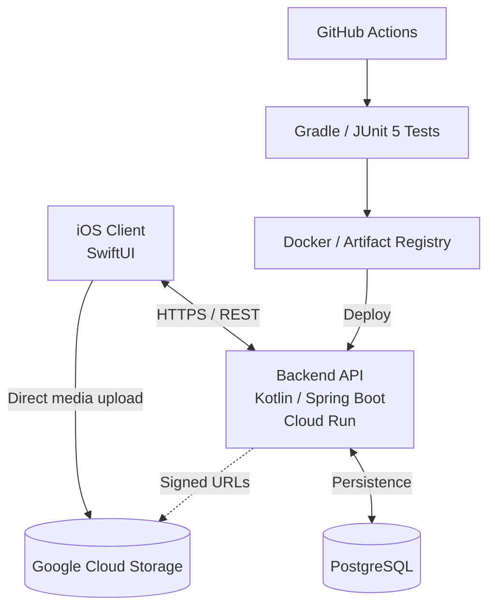

# Sippy — System Architecture

## Overview

Sippy follows a client-server architecture combining a native SwiftUI application, a Kotlin/Spring Boot backend, PostgreSQL, and Google Cloud services.

This document presents a simplified technical overview rather than complete deployment documentation.

## 1. iOS Architecture

The mobile application is developed with SwiftUI and organized around feature modules.

Key responsibilities are separated into:

- **Presentation:** SwiftUI screens and view models.
- **Domain:** Entities, repository interfaces, and use cases.
- **Data:** Network clients, persistence, and repository implementations.

The application communicates with backend services through REST APIs.

Map functionality uses the Mapbox SDK.

## 2. Backend Architecture

The backend is built with Kotlin and Spring Boot.

Key components include:

- REST controllers and application services.
- Relational persistence with PostgreSQL.
- Flyway database migrations.
- Spring Security and JWT-based authentication.
- Role-based and household-scoped access controls.
- Media management using Google Cloud Storage.

The backend uses a modular application structure rather than a collection of independently deployed microservices.

## 3. Media Upload & Access

The media integration uses short-lived signed URLs.

A typical upload follows this sequence:

1. An authenticated client requests an upload URL from the backend.
2. The backend applies relevant checks and generates a signed URL.
3. The client uploads the media directly to Google Cloud Storage.
4. Access to stored media can be provided through signed read URLs.

This design avoids proxying media file contents through the application backend.

## 4. CI/CD Pipeline

The backend repository includes a GitHub Actions workflow.

The configured pipeline:

1. Runs Gradle tests.
2. Builds a Docker image after successful testing.
3. Publishes the image to Google Artifact Registry.
4. Deploys the backend image to Google Cloud Run.

JUnit 5 and Testcontainers are configured for backend testing.

## 5. Engineering Considerations

The architecture emphasizes:

- Separation of responsibilities.
- Maintainable domain and data layers.
- API authorization and access scoping.
- Relational data consistency.
- Managed cloud infrastructure.
- Automated build and deployment workflows.

## 6. Documentation Scope

This is a public-facing, high-level architectural overview.

It intentionally excludes private source code, credentials, infrastructure identifiers, internal endpoints, and detailed security configuration.

The document describes architectural design and implemented integrations, not an independently verified production-readiness assessment.
